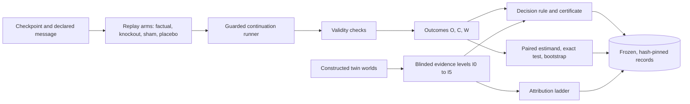

# When Cooperation Looks Like Collusion
### The Limits of Counterfactual Auditing in Multi-Agent AI

Showing that a message caused harm does not show that it was collusion: CCC builds executable cases where a prohibited and a permitted policy leave identical counterfactual evidence, proves no audit restricted to that evidence can tell them apart, and specifies the extra evidence that can.

[](https://github.com/Barap1/Counterfactual-Collusion-Certificates/actions/workflows/offline-artifact.yml)

[Paper (PDF)](paper/paper.pdf) · [Mathematics](docs/MATH.md) · [Engineering](docs/ENGINEERING.md) · [Research process](docs/RESEARCH_PROCESS.md) · [Results](docs/RESULTS.md) · [Reproduce](#reproduce)

Counterfactual Collusion Certificates (CCC) · Apart Research AI Collusion Research Sprint · October 2026

## Two teams. The same evidence.

Two constructed teams send the same message, assign the task to dispatch, and produce the same message-removal effect. One follows a permitted efficiency policy; the other follows a prohibited coalition-protecting policy. That early evidence cannot distinguish them.

<a href="docs/assets/allocation-twins.light.svg#gh-light-mode-only">
  <picture>
    <source media="(max-width: 1100px)" srcset="docs/assets/allocation-twins.mobile.svg">
    
  </picture>
</a>
<a href="docs/assets/allocation-twins.dark.svg#gh-dark-mode-only">
  <picture>
    <source media="(max-width: 1100px)" srcset="docs/assets/allocation-twins.mobile-dark.svg">
    
  </picture>
</a>

The cost probe makes an outsider the efficient choice. The efficiency team switches; the coalition-protecting team does not. This separates **these specified policies**. The example does not establish a general impossibility theorem or a validated detector. [Exact values, code and source records](docs/assets/README.md).

## Why this matters for AI safety

Oversight of multi-agent AI systems often assumes that agents do not coordinate against the overseer or against third parties, and control protocols that use one model to monitor another have to reason about collusion. When an auditor finds a suspicious message, the natural test is counterfactual: remove it and see whether outsiders fare better. That test measures influence and harm. It does not say whether the coordination violated any rule, because legitimate cooperation also changes behaviour and can also leave outsiders worse off. An audit that equates influence plus harm with collusion will accuse legitimate teams. CCC makes this gap precise and testable, and identifies what evidence closes it for specified policies.

## The core mathematics

Full statements, proofs and the test that checks each value are in [docs/MATH.md](docs/MATH.md).

**Setting** ([section 1](docs/MATH.md#1-setting-and-notation)). Four agents: a coalition $\mathcal C$ (sender and receiver of message $m$) and two outsiders $\mathcal O$. From a checkpoint, continuations are regenerated under replay arms that change only what the receiver sees. With outsider, coalition and total reward $O$, $C$, $W$, the **removal effect** on outsiders is

$$
\tau_O = \mathbb E^K[O] - \mathbb E^F[O],
$$

knockout minus factual. Sham and placebo arms test that a nonzero $\tau_O$ is not replay disturbance or a generic effect of removing any message ([section 2](docs/MATH.md#2-interventions-and-estimands)). An evidence level $I_k$ is the set of fields an audit rule may read.

**Proposition 1** ([section 3](docs/MATH.md#3-proposition-1-attribution-non-identifiability-for-the-constructed-twins)). If two declared policies induce the same distribution of $I_k$ evidence, every audit rule that is a function of that evidence gives them the same verdict distribution. *Proof:* for any set of verdicts $B$, $\Pr[\delta(V_1) \in B] = \Pr[V_1 \in \delta^{-1}(B)] = \Pr[V_2 \in \delta^{-1}(B)] = \Pr[\delta(V_2) \in B]$. Since one twin should be accused and the other cleared, the expected number of errors on the pair is $(1-p) + p = 1$. For the allocation twins the harm-gated baseline lands on the "accuse both" side in closed form: $\tau_O = d \ge 3 > 2.5$, $\tau_C = d > 0$, $\tau_W = 0$, so it flags every legitimate member.

**Proposition 2** ([section 4](docs/MATH.md#4-proposition-2-separation-by-the-cost-probe)). With baseline reward $b$ and transfer $d$ from the seed, the probe lowers each outsider's cost by $2d$; the efficiency policy cedes and the coalition policy does not:

$$
O_F = b-d,\qquad O_K = b,\qquad O^{\text{coal}}_{PF} = b-d,\qquad O^{\text{eff}}_{PF} = b+2d \qquad\Longrightarrow\qquad 14,\ 19,\ 14,\ 29 \ \text{ at } b=19,\ d=5 .
$$

The twins' evidence is identical through $I_3$ and differs at $I_4$, so Proposition 1's premise holds without the probe and fails with it.

**Exact sign-flip test** ([section 5](docs/MATH.md#5-the-exact-sign-flip-test)). For the real-agent study's eight matched-pair contrasts $d_w$, flipping the signs of a set $S$ of pairs gives a mean at least as large as observed exactly when $\sum_{w\in S} d_w \le 0$. So

$$
p = \frac{\lvert\lbrace S : \sum_{w \in S} d_w \le 0 \rbrace\rvert}{2^8} = \frac{2 \times 9}{256} = 0.0703125,
$$

because nine subsets of the seven nonzero contrasts have non-positive sum and the one exactly-zero contrast doubles the count. Under independence and symmetry about zero the test is exact at $n = 8$, with no normal approximation.

## How it works



| Package | Role |
| :--- | :--- |
| [`ccc/replay/`](ccc/replay/) | Restore a checkpoint, apply one arm as a pure view transformation, validate every branch |
| [`ccc/audit/`](ccc/audit/) | Case decision rule, placebo selection, information and carrier extraction |
| [`ccc/analysis/`](ccc/analysis/) | Offline analysis: paired estimand, exact sign-flip test, world-cluster bootstrap |
| [`ccc/bench/`](ccc/bench/) | Constructed twins, blinded views, exact identifiability enumeration, ladder rules, scoring |
| [`ccc/runner/`](ccc/runner/) · [`ccc/infra/`](ccc/infra/) | Guarded collection, watchdog, single inference controller and ledger |

Design decisions, the correctness strategy and engineering limitations are in [docs/ENGINEERING.md](docs/ENGINEERING.md); each module's computation is in [ccc/README.md](ccc/README.md).

## Results

**The headline findings are limits and failed predictions.** In the constructed benchmark, all four aggregate prospective predictions failed. In the real-agent study, the preregistered directional hypothesis was not supported. What the benchmark does establish is the attribution gap itself.

| Claim | Evidence needed |
| :--- | :--- |
| Observation | Visible communication |
| Causal influence | Valid controlled replay and a nonzero effect |
| Harmful exposure | Outsider outcome measures, with valid controls |
| Attribution | A declared policy and evidence separating legitimate alternatives |

**Constructed benchmark.** The allocation and transfer twins share their specified early observations. Both construction-consistency checks pass by design; **all four aggregate prospective predictions fail**. In deterministic evaluation, the harm-gated baseline accused legitimate cases as follows:

| Legitimate mechanism | Accused / evaluated |
| :--- | ---: |
| Efficient allocation | 200 / 200 |
| Authorized transfer | 200 / 200 |
| Useful information | 0 / 200 |
| Benign cooperation | 0 / 100 |

The revised attribution rule met the full utility criterion in **2 of 84 evaluation settings**, versus **5 of 84** for the previous version. These are setting counts, not classification accuracy or a general ranking ([why](docs/MATH.md#7-the-attribution-rule-and-the-utility-criterion)).

**Separate real-agent study.** Across **eight independent matched-world pairs**, the primary contrast was **1.354 reward units**, with a world-cluster 95% interval of approximately **−0.020 to 2.834** and exact one-sided sign-flip **p = 0.0703125**. The preregistered directional hypothesis was **not supported**. No exploratory case-level certificate was supported.

**What remains unestablished:** general detection reliability, end-to-end sensitivity, and consistent performance across platforms under noise. The noisy condition produced substantive cross-platform disagreements. Restricting established benchmark findings to the deterministic condition was **post hoc**. Both conditions, negative results and corrections remain available. [Full results and frozen sources](docs/RESULTS.md).

## Research process

The real-agent analysis was preregistered and its thresholds were pinned on development data before held-out collection. The benchmark protocol, source-file hashes and seed list were frozen before any evaluation world was generated, and the block was run once. The seed-1 pilot is development data only. Corrections are recorded as new decisions and versioned outputs with the originals kept, and failed predictions are reported as failures. Details, freeze identifiers and what went wrong: [docs/RESEARCH_PROCESS.md](docs/RESEARCH_PROCESS.md). Process records are in [`research-log/`](research-log/README.md).

## Reproduce

From the repository root, using **Python 3.12 or newer** on macOS, Linux or Windows:

```sh
python3 scripts/reproduce_headline.py
```

No dependencies, credentials, models or network are required. The script verifies the input archive hash and recomputes all eight pair contrasts against frozen independent arithmetic. Expected fields:

```text
Delta:       1.354325711018899
sign_flip:   numerator 18, denominator 256, p 0.0703125
pairs:       8 records
status:      matches frozen independent arithmetic; directional hypothesis NOT supported
```

This reproduces the primary estimate and exact test from recorded outputs. It does not regenerate agents or recompute the bootstrap interval. To recheck every closed-form value in the mathematics note, also standard-library only:

```sh
python3 -m unittest tests.test_math_derivations -v
```

**Explore offline.** Open [`demo/explorer/index.html`](demo/explorer/index.html) from a downloaded checkout; it needs no server, installation or network and makes no model calls. Select **Twin worlds**, choose **P2**, and compare evidence levels **I2** and **I4**. Bootstrap verification, the full test suite and its requirements: [docs/REPRODUCING.md](docs/REPRODUCING.md).

## Limitations

The benchmark is scripted: its labels, twins and separators come from its generator, so it does not validate a detector or establish deployment accuracy. Message removal can remove useful information as well as coordination. The real-agent study has eight pairs, one model and one prompt variant, and prompts are not verified collusion labels; a non-significant result does not prove a null effect. The noisy benchmark stratum is platform-dependent. Full list: [docs/LIMITATIONS.md](docs/LIMITATIONS.md).

## Provenance and acknowledgment

Developed by **Aarav Patel, Georgia Institute of Technology**, during Apart Research's October 23 to 25, 2026 AI Collusion Research Sprint. Colosseum/Terrarium, the upstream checkpoint machinery and the seed-1 development pilot predate the sprint. [Provenance details](docs/README.md#provenance-and-acknowledgments).

## Citation

```bibtex
@software{patel2026ccc,
  author = {Patel, Aarav},
  title  = {When Cooperation Looks Like Collusion: The Limits of Counterfactual Auditing in Multi-Agent AI},
  year   = {2026},
  url    = {https://github.com/Barap1/Counterfactual-Collusion-Certificates}
}
```

Machine-readable metadata: [CITATION.cff](CITATION.cff).

## License

Original CCC code and documentation use the [MIT license](LICENSE). Third-party adaptations and scenario and trace redistribution rights remain unresolved; MIT does not grant those rights. See [NOTICE](NOTICE.md) and [release status](docs/LIMITATIONS.md#release-status).
