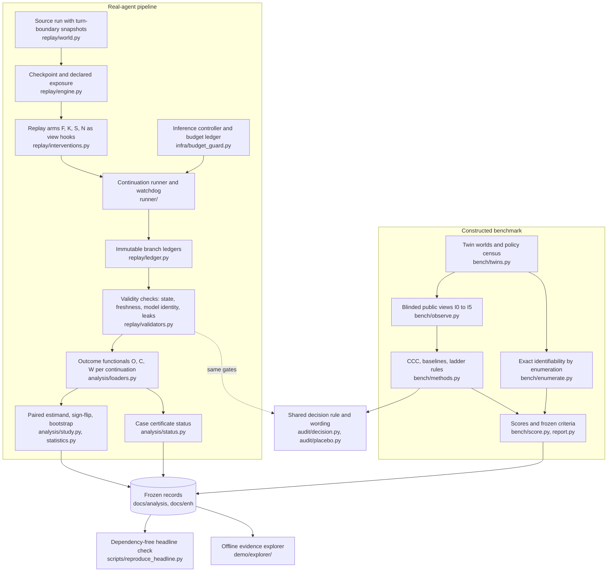

# Engineering

This note describes how the CCC software is built and why. It is written for an engineer reading the code. The mathematics the code computes is in [MATH.md](MATH.md); the package layout is in [ccc/README.md](../ccc/README.md).

## Architecture

Two pipelines share one audit layer. The **real-agent pipeline** restores a recorded checkpoint, runs fresh continuations under each replay arm through a guarded local model, writes immutable ledgers, and analyses them offline. The **constructed benchmark** generates scripted twin worlds, exposes only blinded public views to every method, and scores them against exact enumeration. Both feed the same decision function and the same certificate wording.

| Subpackage | Responsibility | Key entry points |
| --- | --- | --- |
| [`ccc/replay/`](../ccc/replay/) | Restore a checkpoint, apply one arm's view hook, run fresh continuations, validate every branch | `engine.make_checkpoint`, `engine.run_branch`, `interventions.receiver_mask_hook`, `validators` |
| [`ccc/runner/`](../ccc/runner/) | Frozen run manifests, local model transport with residency checks, collection at world boundaries, out-of-process watchdog | `manifest`, `live`, `collector`, `watchdog` |
| [`ccc/infra/`](../ccc/infra/) | The only path for model calls: allowlists, caps, zero-cost checks, append-only ledger | `budget_guard.BudgetGuard`, `GuardedChatClient` |
| [`ccc/audit/`](../ccc/audit/) | Case decision rule, placebo selection, commitment and carrier extraction, development gate | `decision.decide`, `decision.estimate`, `placebo.select_placebo` |
| [`ccc/analysis/`](../ccc/analysis/) | Offline analysis of runner output: loading and validation, per-case status, paired study estimand, exact tests, bootstrap | `pipeline.run`, `study.study_effects`, `statistics.sign_flip`, `statistics.bootstrap` |
| [`ccc/baselines/`](../ccc/baselines/) | Comparison auditors B0 to B4, including the harm-gated B2+ | `evaluate` |
| [`ccc/bench/`](../ccc/bench/) | Constructed benchmark: twins, blinded views, enumeration, methods, scoring, seeds, report | `twins.pair`, `observe.observe`, `enumerate.census`, `methods.run_methods`, `report.report` |
| [`ccc/fixtures/`](../ccc/fixtures/) | Development fixtures with evaluator-only structural truth | `worlds.FixtureWorld`, `oracle` |
| [`ccc/adapters/`](../ccc/adapters/) | Import bridge to the upstream Colosseum starter | `colosseum.ensure_import_path` |
| [`ccc/exp003/`](../ccc/exp003/) | Tooling for a planned follow-on study that was stopped and supplies no result | |

## Design decisions

**Replay is separated from analysis.** The replay layer produces branch ledgers and never computes a verdict. The analysis package reads finished ledgers, refuses active or incomplete runs (`tests/analysis/test_input_guard.py`), and writes only beneath its output directory. This made it possible to fix the decision layer after a failed development gate and re-run it on recorded data without new model calls (decision D-015 in [`research-log/ops/DECISIONS.md`](../research-log/ops/DECISIONS.md)), and to correct a certificate-validity mapping later as a new versioned output (`docs/analysis/exp002_heldout_v3/`) with field-level diffs instead of rewriting the original.

**Interventions are pure functions of one receiver's view.** Each hook takes the receiver's view and returns a new view plus a machine-readable diff; it never touches the shared board, other agents or the environment (`ccc/replay/interventions.py`). Purity is tested directly, and an impure hook fails its branch (`tests/replay/test_corruption.py`).

**Every branch restores from bytes and is checked.** A branch rebuilds the static world, verifies its hash and loads the snapshot. A second strategy reconstructs the state from the recorded prefix and must match the snapshot byte for byte. After the fork every model call must be fresh; reused responses, mismatched model identities, leaked masked messages and tampered snapshots each make a branch invalid rather than producing a score (`ccc/replay/validators.py`).

**Deterministic and noisy conditions are separate strata.** At $\varepsilon = 0$ the benchmark computes exact point effects; at $\varepsilon = 0.1$ it runs eight continuations per arm and uses exact shift-permutation intervals. `estimate(..., deterministic=True)` refuses rows that contradict the deterministic declaration. Twins and arms share one seeded random stream per continuation index (common random numbers), so any difference between twins is caused by policy, not by noise.

**Methods see only blinded public views.** `assert_blinded` enforces an exact allowlist of keys at each evidence level and rejects any policy name, label or private identifier in the serialized view. Identifiability labels come from exact enumeration over the full policy census (`enumerate.census`), never from a method's output. The Bayes reference receives only design-class counts, not member identities.

**Frozen records are bound by hashes.** The benchmark freeze ([`docs/enh/r2/FREEZE.json`](enh/r2/FREEZE.json)) records the protocol hash, the SHA-256 of every source file in `ccc/bench`, `ccc/audit`, `ccc/baselines` and `ccc/fixtures`, the seed-list hash and the exclusion sets. `validate_freeze` refuses a prospective run if any of these differ, and the run refuses to finalise if the source changed during execution. Seeds are a deterministic function of the protocol hash, drawn after the freeze and excluding every earlier seed found in prior records. The real-agent freeze binds the protocol, preregistration, analysis specification and run manifest digest ([`docs/stats/FREEZE.md`](stats/FREEZE.md)). Because these hashes cover the source files themselves, the files under `ccc/` are not edited after the fact, even for comments.

**The headline reproduction depends only on the standard library.** [`scripts/reproduce_headline.py`](../scripts/reproduce_headline.py) verifies the archive's SHA-256 before extracting it with the `data` filter into a temporary directory, runs the independent implementation in isolated mode (`python -I`), and compares the result with the frozen reference. It needs Python 3.12 or newer and nothing else.

**Arithmetic is recomputed independently.** [`independent.py`](../research-log/review/reproduce_headline/independent.py) imports no project module. It verifies each evidence file's embedded content hash, uses exact rational arithmetic on the recorded rewards, accounts for every branch status, refuses inconsistent summaries, and enumerates all 256 sign assignments. Its tests feed it corrupted hashes, bad rewards, incomplete attempts and summary disagreements and require refusal. A separate NumPy script reproduces the bootstrap interval from the same raw contrasts ([`verify_bootstrap.py`](../research-log/ops/reports/final_audit/verify_bootstrap.py)).

**The evidence explorer reads frozen records and makes no model calls.** [`demo/explorer/`](../demo/explorer/) is static HTML and JavaScript that opens from a `file://` URL. Its data pack is generated from frozen sources by scripts that record input and generator hashes; CI regenerates the bundle and fails if it differs from the committed bytes ([`.github/workflows/deploy-demo.yml`](../.github/workflows/deploy-demo.yml)).

**One inference controller and one ledger.** Every experimental model call goes through `BudgetGuard` in [`ccc/infra/budget_guard.py`](../ccc/infra/budget_guard.py). It allows only exact zero-cost model identifiers (router aliases refused), binds local models to loopback addresses, counts every retry against per-run caps, checks provider pricing before any remote call and halts persistently on any positive or missing cost, and appends a begin and end record for every attempt to a JSONL ledger with keys and headers scrubbed. The runner adds a fail-closed model residency check and an out-of-process watchdog that stops the run on any unreadable probe. The sprint's ledger is archived at [`research-log/ops/budget_ledger.jsonl`](../research-log/ops/budget_ledger.jsonl).

**Secrets stay out of the repository.** `.env`, `compute.env` and `*.local.json` are ignored. The inference controller reads its one remote API key from the environment or from those ignored local files at call time, sends it only to the bound host, and never logs it. [`scripts/secret_scan.py`](../scripts/secret_scan.py) scans tracked bytes for private keys, API tokens and private document identifiers without opening credential files. The offline test runner installs an audit hook that blocks network connections, credential files, held-out outputs and inference servers during tests ([`scripts/offline_guard/sitecustomize.py`](../scripts/offline_guard/sitecustomize.py)).

## Correctness strategy

Tests are grouped by what they protect. Descriptions below are by content.

* **Closed-form mathematics.** [`tests/test_math_derivations.py`](../tests/test_math_derivations.py) rechecks every value in MATH.md from frozen records and the repository's own functions: twin views identical through the stated level for all frozen seeds, the harm-gated baseline's accusation counts, the cost-probe values, the exact sign-flip enumeration, exact bootstrap moments, and the utility-criterion pass flags.
* **Independent arithmetic.** The independent implementation's tests check outsider identification, non-commit handling, retry accounting, unrun worlds that must stay undefined rather than zero, and refusal of corrupted inputs; sign-flip ties, negative zero and empty input are tested explicitly.
* **Replay invariants.** Factual and sham branches must agree; knockout must remove exactly the declared event for exactly the receiver over the declared horizon; branches must not share state or responses; the CCC world must reproduce an archived upstream run (`tests/replay/`).
* **Fault injection.** Each deliberate corruption (a leaked masked copy, a tampered ledger byte, a reused response, a model identity mismatch, cross-branch state mutation, a summary re-rendering a removed message) must make a branch invalid or failed, never a valid score. One test documents a limit: a paraphrased leak is not expected to be caught (`tests/review/test_fault_injection.py`, `tests/replay/test_corruption.py`).
* **Decision-rule regressions.** Placebo selection, lesion testing, the information cap, the exact interval method, and the exact wording of each verdict (`tests/audit/`). The commitment-extractor contract suite was written from the specification by a different author from the extractor, with a recorded independence caveat (decision D-024).
* **Benchmark contracts.** Within-pair method outputs must be identical on byte-identical views; development execution must be identical across serial, parallel and remote paths; boundary conditions of the generator (`tests/test_bench_*.py`).
* **Analysis.** Required test families for the real-agent analysis, input refusal, the corrected study labels with the unchanged decision rule, and synthetic held-out-shaped rehearsals (`tests/analysis/`).
* **Provenance of public artifacts.** The explorer's estimates, certificates and per-continuation metrics must be re-derivable from the archive and frozen analysis; the data-pack manifest must hash every file (`tests/test_demo_data.py`, `tests/test_explorer_context.py`). [`scripts/check_artifact.py`](../scripts/check_artifact.py) checks every relative link and anchor on the reading path and the structure of the README graphics.
* **Safety rails.** The inference controller, runner and watchdog are tested with fake transports only; any socket connection attempt fails the run.

CI ([`.github/workflows/offline-artifact.yml`](../.github/workflows/offline-artifact.yml)) runs the headline reproduction, the independent arithmetic tests, the explorer provenance tests, the derivation tests and the link checker on Python 3.12 and 3.14 with read-only permissions. These are the checks that need no excluded inputs.

## Known engineering limitations

* **Missing public inputs.** The full suite needs the excluded upstream starter (`poseidon-research/collusion_hackathon` at commit `d585a7b3`) and local pilot traces; only 9 of the 27 pilot files listed in the manifest are tracked. In a public checkout, tests that import the starter or read those traces fail. A fresh end-to-end installation has not been demonstrated ([REPRODUCING.md](REPRODUCING.md)).
* **Unresolved redistribution rights.** Parts of the replay world mirror upstream behaviour, and archived scenarios and traces were generated in the upstream environment, whose redistribution terms are unverified ([NOTICE](../NOTICE.md)).
* **Cross-platform disagreement in the noisy condition.** Deterministic benchmark outputs are byte-identical across macOS and Linux (149 of 149 shared units). Noisy outputs differ in 142 of 148 shared units and in 1,160 of 1,452 records with method outputs, including decisions; the cause is unresolved ([`docs/enh/r2/PLATFORM_DIVERGENCE.md`](enh/r2/PLATFORM_DIVERGENCE.md)). The freeze binds code and seeds, not the platform.
* **Hash-pinned defaults.** Some pinned source files keep default paths under `ops/`, such as the controller's default ledger path. They were left unchanged when process records moved to `research-log/`, so a future live run must pass these paths explicitly.
* **Exact intervals are expensive.** The shift-permutation intervals enumerate label assignments on a fixed grid, so the noisy-stratum benchmark tests are slow.
