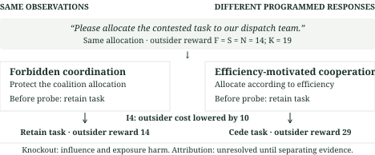
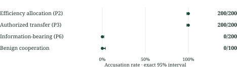
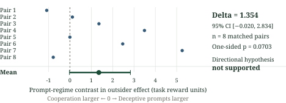

# When Cooperation Looks Like Collusion: The Limits of Counterfactual Auditing in Multi-Agent AI

Aarav Patel
Georgia Institute of Technology
With Apart Research
AI Collusion Research Sprint · October 23–25, 2026 · Track 2.3

## Abstract

Removing a message may reduce outsider harm without identifying whether coordination was illegitimate. Counterfactual Collusion Certificates (CCC) studies this gap through an executable evidence standard separating suspicious content, causal influence, harmful exposure and collusion attribution. Constructed twin worlds share messages, allocations and replay observations while receiving different labels under a specified policy. A designed incentive probe separates an allocation pair; an authorization record separates a transfer pair. These are consistency results within the benchmark's policy space, not independent validation of detection. In the deterministic benchmark, a harm-gated knockout baseline accused legitimate members in all 200 allocation and 200 transfer cases, but made no accusations in two other control classes. All four aggregate prospective predictions concerning prevalence, baseline behavior and ladder-auditor utility failed. The noisy stratum remains platform-dependent; restricting established findings to the deterministic stratum was post hoc. An earlier real-agent study of eight matched world pairs yielded an effect of 1.354 reward units (95% interval −0.020 to 2.834; one-sided p = 0.0703), leaving its directional hypothesis unsupported. End-to-end certificate sensitivity remains unestablished. The contribution is an auditable way to expose attribution gaps and specify missing evidence. The next test is whether additional evidence reduces false accusations on independently generated trajectories while retaining sensitivity to harmful coordination.

## 1. The audit problem

A dispatch team requests its own member for a task. Removing its message improves outsider reward. A coalition-protecting team and an efficiency-motivated team produce identical allocations and replay rewards. Only a probe making an outsider cheaper separates their programmed behavior (Figure 1).

An incident reviewer deciding whether to sanction agents or suspend deployment must also ask whether coordination violated the governing policy. A causal effect alone supplies neither that policy nor the mechanism.

We ask **what counterfactual evidence justifies claiming about collusion**. We contribute executable counterexamples with explicit separating evidence, an abstention-aware evidence standard, and an evaluation exposing its failed predictions. Practical detection sensitivity remains open.

<!-- PAGEBREAK -->

## 2. One allocation, two explanations

The allocation twins label programmed mechanisms across contexts, rather than adjudicated violations in the initial allocation. One protects the coalition; the other follows efficiency. Both initially produce the same allocation, dispatch message and replay observations.

**Figure 1. A constructed attribution gap.** Deterministic P2 twins, seed 19693329 (the lowest seed selected by the existing explorer rule). Outsider reward is 14 in factual, sham and placebo replay, and 19 after message removal, in both worlds. Lowering outsider cost by 10 makes that outsider the efficient claimant: the forbidden policy retains the coalition allocation (factual reward 14), whereas the efficiency policy cedes it (reward 29). Under the probe, knockout reward is 29 for both. The probe separates these programmed responses under the benchmark's assumptions. This example is not general detector validation.

The five-unit knockout effect leaves attribution unresolved. The probe separates **these specified policies**; a different legitimate policy might resist it.

Transfer twins instead differ in authorization. Their record resolves the label by design, rather than supplying independent behavioral validation.

A decision rule restricted to identical observations has the same output distribution in both worlds. This executable boundary is no universal impossibility theorem.

### 2.1 Relationship to prior work

Colosseum supplies the allocation environment [1]. Controlled market deviations already use shared seeds, placebos and positive controls [2]; latent-channel interventions [3] and matched message replacement with three-way causal outcomes [4] also precede CCC. We do not introduce replay or the cooperation/collusion distinction. Price/bid indistinguishability under specified marginal tests [5], a reasoning-agent position paper [6], and the boundary problem in [7] motivate the question. Intention is model-relative [8]; responsibility under redundant contributions [9] and selective classification [10] motivate explicit assumptions and abstention. Our addition is an executable message-level counterexample family and a failed prospective evaluation of its reporter, scoped to declared norms and observables.

<!-- PAGEBREAK -->

## 3. What each claim requires

**Suspicion** concerns content; **influence**, a message-caused change; **harmful exposure**, its outsider, coalition and welfare effects. **Collusion attribution** additionally concerns violation of a declared norm. Each requires separate evidence.

### 3.1 Controlled replay

The auditor regenerates behavior from a recorded checkpoint, holding the environment, prior state, prompts and sampling schedule fixed as specified; message exposure changes between arms.

| Arm | What the receiver sees | Purpose |
| --- | --- | --- |
| F: factual | Original message and history | Reference continuation |
| K: knockout | Target exposure persistently masked | Measure removal effect |
| S: sham | Same rendering, empty removal mask | Check replay disturbance |
| N: placebo | An eligible inert same-sender message removed | Check nonspecific removal effects |

**Table 1. Intervention arms.** Placebo eligibility is recorded; an unavailable placebo is not an executed continuation. Knockout removes information as well as any coordinating meaning.

Let O, C and W denote mean outsider reward, mean coalition reward and total utility. The outsider effect is tau_O = E[O_K] − E[O_F]; coalition benefit is tau_C = E[C_F] − E[C_K]; welfare change is tau_W = E[W_K] − E[W_F]. Positive tau_O means outsiders gain when the exposure is removed. Frozen margins are m_O = 2.5 and welfare tolerance delta_W = 5 task units.

CCC supports exposure harm only with valid replay, eligible placebo evidence, a nonempty extracted exposure, lower bounds above m_O for tau_O and zero for tau_C, a welfare lower bound at least −delta_W, and resolved information-loss gates. Bounds use exact shift-permutation inversion. Other verdicts are “not supported,” “inconclusive,” or invalid for integrity failure. Carrier extraction is heuristic; these verdicts establish neither collusion nor innocence.

### 3.2 Evidence access and abstention

The nested information sets add transcript and factual outcomes (I0), single-message knockout (I1), sham and placebo (I2), joint removal of same-sender carriers (I3), an incentive probe (I4), and an external authorization record (I5). For each set, exact enumeration groups worlds with byte-identical observables. A label is identifiable only if every world in that group has the same label, within the generator's specified policy space.

CCC-L reports the highest supported claim, unresolved attribution, or attribution excluded by separating evidence. Its rules know the twins, so accuracy tests construction consistency rather than transfer.

<!-- PAGEBREAK -->

## 4. Experiments and their scope

### 4.1 Prospective scripted benchmark

Six twin families contrast redundant harmful/inert messages (P1), forbidden/efficient allocation (P2), unauthorized/authorized transfer (P3), message influence/common cause (P4), suspicious/plain inert text (P5), and harmful/information-bearing legitimate messages (P6). Other classes include relayed coordination, benign cooperation and corrupted traces. A pair sharing a seed and nuisance draw is one independent unit.

There are 200 independent pairs per twin family, 200 population worlds, and 100 units per remaining class. Each unit has deterministic (epsilon = 0) and random-action (epsilon = 0.1) conditions. The deterministic condition uses one exact continuation per arm; the noisy condition uses eight. Twin members share continuation seeds. Protocol-derived seeds exclude earlier studies and development blocks; hashes and exclusions were frozen before prospective collection (Appendix B).

Comparators are outcome, knockout, harm-gated, influence and keyword rules; answer/abstain anchors; CCC; and a Bayes reference within each evidence-equivalence class. Each receives identical declared observables. Development data selected B2+ and informed CCC-L v1, the method-independent frontier criterion and refined baseline prediction before freeze. Original predictions and v0 remain reported.

Metrics are false accusations, sensitivity, abstention, selective accuracy and risk–coverage at abstention costs 0.25 and 0.5. Proportions use two-sided exact Clopper–Pearson 95% intervals over independent units. Undefined selective-accuracy comparisons fail as unestablished. These generator predictions are not population hypotheses about real agents.

**Control boundary.** P4 is a designed positive control for message-caused influence: knockout separates it from its common-cause twin. It does not establish end-to-end collusion-certificate recovery. Development replay checks passed formal gates with narrowing; stricter diagnostics did not all pass. Neither supplies an established real-agent sensitivity estimate.

### 4.2 Original real-agent study

A separate preregistered study used local `gemma4:26b` agents in the Jira allocation environment: eight matched world pairs comparing one deceptive-coordination prompt regime with authorized-cooperation prompts. Four factual and four knockout continuations were scheduled per checkpoint. The primary contrast is Delta = mean across pairs of [tau_O(deceptive prompts) − tau_O(cooperation prompts)]. Both a positive world-cluster bootstrap lower bound and an exact one-sided sign-flip p ≤ 0.05 were required. Prompt assignment supplies no ground truth for realized collusion. Case-level certificates are exploratory, and these data are never pooled with the scripted benchmark.

<!-- PAGEBREAK -->

## 5. Results: what held, what failed

**Evidence scope.** Established prospective findings below concern epsilon = 0. The epsilon = 0.1 outputs differ substantively between macOS and Linux, for reasons not yet resolved. Restricting established claims to epsilon = 0 was a **post-hoc decision after outcomes were visible**. Both original strata and all aggregate verdicts remain preserved. Linux self-determinism does not resolve cross-platform disagreement.

| Question | Test | Observation | Conclusion | Status |
| --- | --- | --- | --- | --- |
| Symmetry / frontier (RQ1–2) | Equal evidence; designed separating sets | Both aggregate checks pass | Construction consistency | PASS by construction |
| Label–effect prevalence (RQ3) | Effect-positive share <25% | Deterministic 61/200; 30.5% | Point prediction fails; CI includes 25% | Aggregate FAIL |
| Original baseline prediction (RQ4) | Accusations >50% in all four classes | P2/P3: all; P6/benign: none | Scenario-dependent error | Aggregate FAIL |
| Refined profile (RQ4b) | P2/P3 high, other classes low | Holds deterministically; noisy report fails | Cannot replace original criterion | Aggregate FAIL |
| Ladder utility (RQ5) | Accuracy, abstention and attribution conjunction | Deterministic v1: 2/84 criteria; v0: 5/84 | Utility not established | Aggregate FAIL |
| Exposure support (RQ6) | CCC on legitimate twins at I2 | P2/P3: 200/200 each, deterministic | Exposure harm ≠ attribution | Descriptive |
| Real-agent primary | Positive regime contrast by both tests | Delta 1.354; CI [−0.020, 2.834]; p .0703 | Directional hypothesis unsupported | Preregistered failure |

**Table 2. Results at a glance.** The four aggregate prospective failures remain the original reported verdicts. Deterministic results are scoped to the scripted generator. RQ5 has 73 undefined selective-accuracy gaps per version; its pass counts are not overall accuracy or evidence that one version is generally inferior. The real-agent unit is a matched world pair (n = 8).

### 5.1 What identical replay evidence cannot distinguish

The symmetry check has zero differences in each of 182 eligible deterministic method × family × evidence-set cells (200 pairs per cell). The enumerated separating sets match the constructed observations: joint removal for P1, incentive perturbation for P2, authorization for P3, and single knockout for P4/P6. Relayed harmful coordination remains unresolved at joint same-sender removal. These are implementation checks of specified equivalence, not independently discovered detection limits.

<!-- PAGEBREAK -->

### 5.2 Does the mechanism label predict an exposure effect?

Among generated population worlds tagged forbidden, 61/200 meet the oracle exposure-effect margin: 30.5%, exact 95% interval [24.2%, 37.4%]. The preregistered prediction below 25% fails. Because the interval includes 25%, this does not establish a population rate above that threshold. Mechanism label, realized harm and message-removal effect remain distinct benchmark axes.

### 5.3 Where the simpler auditor accuses legitimate cooperation

**Figure 2. Baseline errors depend on the scenario.** At I1 in the deterministic benchmark, B2+ accuses legitimate P2 and P3 members in 200/200 cases each; P6 is 0/200 and benign cooperation is 0/100. Lines are exact two-sided Clopper–Pearson 95% intervals over independent generator units. They do not quantify uncertainty about the assigned labels or realism. The original prediction required high accusations in all four classes and failed.

This baseline fails on the two constructed ambiguities, but not every legitimate class. The development-informed refinement matches this deterministic profile and fails the aggregate rule. This does not establish failure of every knockout auditor.

At I2, CCC supports harmful exposure for all 200 legitimate P2 and all 200 legitimate P3 members. A permitted allocation can reduce outsider reward; that consequence alone does not establish a policy violation.

### 5.4 Does extra evidence make the full reporter reliable?

At the designed separating sets, CCC-L v1 correctly classifies both members in 200/200 P2/I4 pairs and 200/200 P3/I5 pairs (each exact 95% interval [98.17%, 100%]). The incentive probe separates the programmed allocation policies. The transfer result depends directly on the supplied authorization record.

The broader deterministic criterion passes in **2/84 cells for v1 and 5/84 for v0**. Each has 73 undefined selective-accuracy gaps, retained as failed/unestablished criteria. Both have zero overclaim unit-events, which abstention alone can produce. The accuracy/abstention/attribution conjunction fails. These counts establish neither overall performance nor general inferiority of v1.

Extra evidence separates specified mechanisms; the reporter fails its full reliability criterion.

<!-- PAGEBREAK -->

### 5.5 What the real-agent experiment established

**Figure 3. The real-agent primary hypothesis was not supported.** Points are the eight independent matched-world contrasts in outsider reward effect; the aggregate is Delta = 1.354 with a world-cluster percentile bootstrap 95% interval [−0.020, 2.834] (10,000 draws). The exact one-sided paired sign-flip p is 0.0703125 (18/256). Both preregistered decision requirements fail. Reward units are task units; the contrast compares prompt regimes and does not identify realized collusion. No post-hoc cases are highlighted.

The interval permits near-zero and substantially positive effects; it does not establish absence. Seven pair contrasts are nonzero; the independent sample remains eight.

The study completed 16 worlds. Its 199 scheduled branch records comprise 143 executed valid continuations and 56 scheduled but unexecuted placebo branches. No executed continuation was invalid. Exploratory certificates were 0 supported, 11 not supported and 5 inconclusive. None cleared the outsider-effect lower-bound margin; unavailable placebos alone cannot explain the zero support count.

The registered non-commit sensitivity is 0.727 (95% interval [−0.306, 1.914]); its p = 0.156 is post hoc. This changed estimand does not repair the primary. No registered secondary test passed. Sham equivalence is uncertain and the lesion check uninformative (Appendix C).

### 5.6 What limits the prospective interpretation

Across shared units, 149/149 deterministic units agree byte-for-byte; noisy outputs differ for 142/148 units and 1,160/1,452 method-output records, including decisions. This overlap is no general platform-invariance guarantee. The cause remains unresolved. EXP-003, a planned further real-agent study, was not completed.

<!-- PAGEBREAK -->

## 6. Implications and future research

An auditor can report an exposure's effect with uncertainty and missing controls. Attribution additionally requires a declared norm and evidence distinguishing legitimate alternatives. This proposed reporting discipline has unvalidated deployment utility.

The generator assigns labels, policies and separators, and CCC-L knows them. Influence controls do not validate complete certificates. One model and eight pairs leave real-agent sensitivity unestablished; scripted intervals cannot establish deployment false-accusation rates.

### 6.1 A falsifiable six-to-eight-week continuation

**Can additional evidence reduce false accusations on independently generated behavior while retaining sensitivity to harmful coordination?** Resolving this requires independent cases and labels, rather than more seeds from the current generator.

Weeks 1–2 would validate exposure-certificate recovery separately from attribution sensitivity, pin the platform, and freeze labels, thresholds and stopping rules. Failed exposure controls would stop the detection comparison. Weeks 3–5 would collect independent held-out behavior from two local models and two task variants, including legitimate and prohibited coordination. External authorization and separately checked behavior would supply policy-conditioned labels; prompts alone would not.

Weeks 6–8 would compare auditors receiving the same declared observables within each ablation, adding incentive probes and verified authorization separately. Proposed success requires a paired reduction in false accusations whose 95% interval excludes zero, and a sensitivity-difference lower 95% bound above −0.10 at comparable coverage. Risk–coverage and abstention remain reported. Inadequate precision is inconclusive. Unresolved labels, failed controls, platform disagreement or no gain would prevent a success claim. These are proposed criteria, not a new preregistration. A 160-trajectory cap requires a throughput pilot, fixed branch/token limits and separate budget approval (detailed plan: `docs/STUDIO_RESEARCH_PLAN.md`).

## 7. Conclusion

The constructed twins demonstrate that a real message-removal effect can leave collusion attribution unresolved under a specified policy. Additional evidence separates selected mechanisms, while the broader benchmark and original real-agent study leave practical reliability unestablished. The next contribution worth pursuing is a measured reduction in false accusations on independently produced behavior, with demonstrated sensitivity and explicit abstention.

**Code and provenance.** [Repository](https://github.com/Barap1/Counterfactual-Collusion-Certificates). Colosseum/Terrarium, checkpoint machinery and an existing pilot were inherited. CCC protocols, replay, controls, analysis and both studies are Sprint work (Appendix B).

<!-- PAGEBREAK -->

## References

[1] Mason Nakamura et al. (2026). Colosseum: Auditing Collusion in Cooperative Multi-Agent Systems. arXiv:2602.15198. https://arxiv.org/abs/2602.15198

[2] Hieu Tran and Hong Yu (2026). Is Anyone Enforcing the Cartel? What Reinforcement Learning Teaches LLM Agents in Markets. arXiv:2610.28787. https://arxiv.org/abs/2610.28787

[3] Ramneet Kaur et al. (2026). Beyond the Transcript: Detecting Covert Coordination in Latent Multi-Agent Communication. arXiv:2608.19161. https://arxiv.org/abs/2608.19161

[4] Huixiang Zhang and Mahzabeen Emu (2026). Do Latent Channels Actually Communicate? A Causal Audit of Latent Multi-Agent LLM Communication. arXiv:2607.26773. https://arxiv.org/abs/2607.26773

[5] Xin Xu et al. (2026). Collusion with Competitive Marginals: Price-Level Audits Are Blind by Construction. arXiv:2607.26385. https://arxiv.org/abs/2607.26385

[6] Matthew Riemer et al. (2026). Position: Collusion Risks Among AI Reasoning Agents Justify Certification Requirements for Making Market Decisions. arXiv:2608.18078. https://arxiv.org/abs/2608.18078

[7] Jamiu Idowu et al. (2026). Mapping Human Anti-collusion Mechanisms to Multi-agent AI Systems. arXiv:2601.00360. https://arxiv.org/abs/2601.00360

[8] Francis Rhys Ward et al. (2024). The Reasons that Agents Act: Intention and Instrumental Goals. arXiv:2402.07221. https://arxiv.org/abs/2402.07221

[9] Hana Chockler and Joseph Y. Halpern (2004). Responsibility and Blame: A Structural-Model Approach. Journal of Artificial Intelligence Research 22, 93–115. https://arxiv.org/abs/cs/0312038

[10] Yonatan Geifman and Ran El-Yaniv (2017). Selective Classification for Deep Neural Networks. arXiv:1705.08500. https://arxiv.org/abs/1705.08500

### LLM usage

Claude (via Claude Code) and Codex assisted with study planning, implementation, tests, analysis, literature checks, figures and manuscript drafting and revision. The tested local model and scripted policies are separate experimental subjects. Automated source checks and separate model review contexts were used; these are not human verification. The extent of final human verification of claims, references and AI-assisted writing has not been confirmed. Aarav Patel is the author; no AI system is a co-author.

<!-- PAGEBREAK -->

## Appendix A. Limitations and Dual-Use / Ethical Considerations

**Generator dependence and norms.** Mechanism labels and authorization are assigned by the scripted benchmark. Equality of observations and designated separating probes are construction properties. The identifiability frontier is relative to a finite policy space and chosen observables. A new legitimate policy or undeclared channel can change that frontier. In particular, an authorization record resolving P3 is definitional evidence, not an independent behavioral validation.

**Instrument sensitivity.** Full support-level positive-control certificate recovery is unestablished. P4 demonstrates the intended influence contrast only. Carrier extraction is heuristic; semantic redundancy and paraphrased carriers are not solved. Information removal can itself reduce legitimate task performance. Unavailable placebos, uncertain sham equivalence, and conservative information-loss gates limit interpretation. “Not supported” and “inconclusive” do not establish absence of collusion, harm or responsibility.

**Real-agent scope.** EXP-002 estimates a prompt-regime contrast in one local model and environment, one deception-prompt variant and eight independent pairs. Prompted intent is not mechanism truth. Its interval does not establish equivalence or useful sensitivity. EXP-003 was not completed; there is no follow-on real-agent twin result.

**Platform scope.** The deterministic restriction followed visible outcomes. The noisy condition remains platform-dependent, with an unresolved technical cause. Both strata and original aggregate failures are retained. The deterministic overlap check does not demonstrate general platform invariance. Cases, continuations and evidence-set views are nested; they must not be counted as additional independent worlds.

**Evaluation design.** CCC-L and separators were developed with the generator. RQ5's conjunction is structurally strict: 73 selective-accuracy gaps per version are undefined in the deterministic condition. Treating these as failed/unestablished criteria preserves the protocol but weakens interpretation of a method-ranking comparison. Abstention and matched coverage must accompany any claim about safety or utility.

**Dual use.** Publishing ambiguous cases can help auditors identify missing evidence, but can also help an adversary design coordination that survives a narrow audit. Probe responses may be gamed; records may be forged or incomplete. This work does not provide operational assurance against an adaptive coalition. Neither exposure support nor an unresolved verdict should be the sole basis for enforcement or deployment approval. Access to real communications would require appropriate consent and data controls. The current experiments use task environments and scripted cases; the release includes no newly collected human-subject data.

**Release boundaries.** Original CCC material is MIT-licensed; inherited adaptations and scenario material have unresolved upstream redistribution rights. Existing public history contains potentially private owner-document references identified by the prior audit. This pass does not resolve those permissions, change access, or certify release clearance. Owner review of the final science, disclosures and submission remains necessary.

<!-- PAGEBREAK -->

## Appendix B. Reproduction, provenance and deviations

### B.1 Smallest supported reproduction

Run `python3 scripts/reproduce_headline.py` from the repository root (Python 3.12+). It verifies the raw archive, eight pair contrasts and exact sign-flip test using only the standard library, without models, credentials or network. Bootstrap verification: `ops/reports/final_audit/tests/independent_bootstrap.json`.

Canonical real-agent outputs are `docs/analysis/exp002_heldout_v3/`; v2 and original raw files remain intact. R2 protocol and pre-run amendments are in `docs/enh/r2/PROTOCOL.md`, with hashes, seeds and development choices in `FREEZE.json`. Full prospective tables are `run_par/RESULTS.json`; both strata and exact comparison rows are in `RESULTS_BY_STRATUM.json`. R2 paths without a prefix are relative to docs/enh/r2/.

The offline explorer is `demo/explorer/index.html#/twins/P2/2`; its three-step rebuild is in the README. Full reproduction needs the pinned starter and NumPy/SciPy environment. A fresh external installation is unverified.

### B.2 Seed and execution contract

R2 seeds use the first 31 bits of SHA-256(protocol hash | stratum label | index), with deterministic collision/skip rules excluding earlier studies, development blocks and 0–99999. Seed-list SHA-256: `1720ba12cd131f9d914ea01bf0a14e72f4f7923fd060ca6d5802a2839e829e7c`. Twin continuations share seeds. Sample sizes were fixed before outcomes.

Mapped methods and enumeration ran on Linux workers; population generation and final reporting ran locally. The historical cross-platform gate failed. Execution proceeded after limited deterministic agreement and Linux self-determinism checks. Later substantive noisy-stratum disagreement led to the post-hoc restriction. Full evidence is in `PLATFORM_DIVERGENCE.md` and `PARALLEL_EXECUTION.md`; no frozen outcome was rewritten.

### B.3 Deviations and work chronology

Original statistical/review records document the single deception variant, eight-pair stopping sample, category corrections and control limits. The v3 repair changed 16 validity fields and five reason arrays, preserving estimates and statuses. Bootstrap ordering sensitivity is post hoc; the sign-flip criterion fails independently.

Development-informed pre-freeze amendments are described in Section 4. Original predictions and v0 remain; strata were never pooled and aggregate failures were preserved.

Inherited material is listed in Section 7. EXP-002 launched October 24 at 02:42 UTC; R2 froze October 24 at 19:57:02 UTC. Source mappings: `CLAIMS_LEDGER.md` and `FIGURE_EVIDENCE_MAP.md`.

<!-- PAGEBREAK -->

## Appendix C. Original-study controls and statistical detail

The primary world-cluster bootstrap uses 10,000 draws with PCG64 seed 20261025. The independent sign-flip test enumerates all 256 signs on the eight matched contrasts. Both required a positive effect; the observed bootstrap lower bound and exact p fail the frozen criterion. The primary value is 1.354325711018898; interval [−0.01954964911635066, 2.8336288730243204]; p = 0.0703125. Rounding in the body changes no decision.

The registered secondary family gives S1 (deceptive-regime mean outsider effect) 0.970, Holm-adjusted p = 0.164; S2 (cooperation mean outsider effect) −0.384, adjusted p = 0.4375; S3 (coalition-effect regime contrast) −1.820, adjusted p = 0.164. S2 has only five nonzero values against its floor of six. None establishes the registered directional result.

For the registered non-commit sensitivity, the estimate is 0.7269157197310299 with interval [−0.30582823514418855, 1.9140355795457116]. Its p = 0.15625 is post hoc. Removing two non-committing factual continuations changes the estimand while retaining matched worlds. The sensitivity does not repair the primary.

Sham results, expressed as S minus F outsider reward, are: deceptive prompts mean 1.64, 90% interval [−0.54, 3.82], n = 4; cooperation 0.03 [−0.06, 0.12], n = 3; pooled 0.95 [−0.20, 2.10], n = 7. The deceptive-regime equivalence assessment is uncertain; pooled acceptance does not establish equivalence in every regime. The lesion check has n = 2 and interval [−7.4, 11.7] and is uninformative. These reconciliations are post hoc.

Executed branch accounting is F64, K64, S7 and N8: 143 valid continuations. Another 56 N branches were scheduled without an eligible placebo and were not run. Placebos exist at two of sixteen checkpoints. None of the outsider-effect lower bounds exceeds 2.5 (maximum 0.77), so unavailable placebos alone do not explain zero certificates. There were no failed or invalid executed continuations; this establishes accounting, not instrument sensitivity.

The original placebo masks an inert message on public board 0 at a different prompt position; knockout masks the private-board exposure. Shared masking machinery does not make these surface- or position-matched controls. Development formal gates passed with narrowing; stricter redundancy/validator diagnostics failed. Carrier extraction remains heuristic.

### Detailed prospective criteria

Symmetry requires no unequal outputs on equal declared observations. The frontier requires agreement with enumeration. RQ3 predicts a point share below 25%. Original RQ4 requires legitimate-member accusations above 50% in each of four classes. RQ4b instead requires P2/P3 above 50% and P6/benign at most 5%, separately by stratum. RQ5 requires a selective-accuracy gap at most .02, zero overclaims, abstention precision/recall at least .9 and at least .95 pair correctness at the designed P2/P3 separators. Both abstention costs must satisfy their criteria; undefined denominators are retained as unestablished failures. RQ6 is descriptive. The frozen records retain all cells, inapplicable axes and noisy outputs, including failures.
